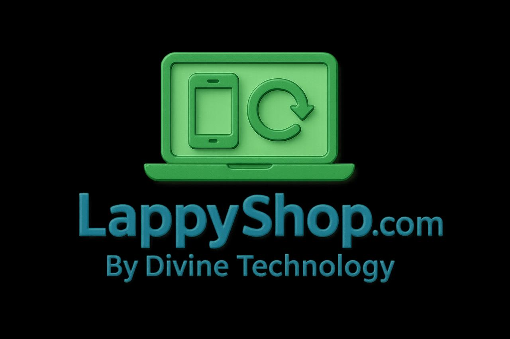
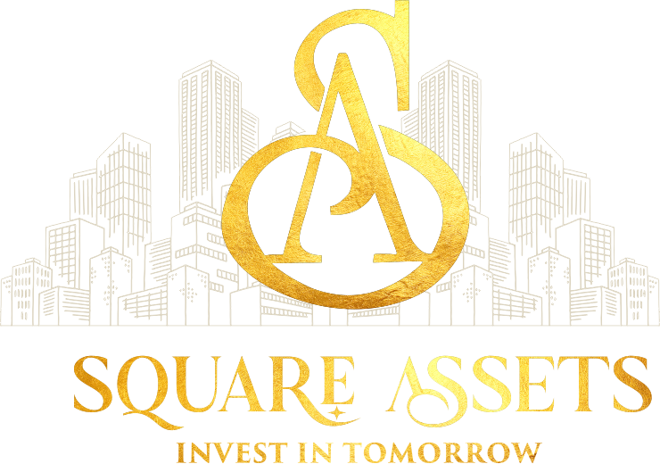
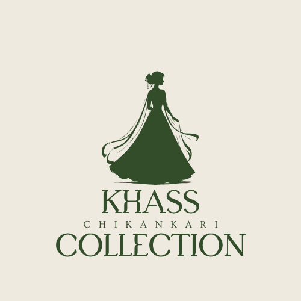

#  👋 Hi, I’m Arbab Ahmad Khan — Im-Arbab

  

  

## Arbab Ahmad Khan (Im-Arbab)

Frontend-focused developer building delightful, accessible web apps.

- 🔭 Live: LappyShop, Square-Assets, NorthStar CRM 
- 🌱 Learning: advanced React patterns & MERN stack  
- 💬 Ask me about JavaScript, UI design, and performance  
- 📫 arbabahmadkhan9@gmail.com

---

## Featured projects

  
  
  
  

### Quick links
- Portfolio / Live: https://arbabahmedkhan-portfolio.netlify.app/  
- LinkedIn: https://www.linkedin.com/in/arbab-ahmad-khan

---

## Tech & Tools

  
  
  
  
  
  
  
  
  

### Tools & Platforms

  
  
  
  
  

---

---

## 🚀 About Me

I'm a passionate **Full Stack Developer** crafting modern, scalable web applications with clean code and creative solutions. I specialize in MERN stack development and thrive on turning ideas into reality through technology! 💻✨

- 🔨 Building beautiful web experiences
- 📚 Continuously learning and growing
- 🤝 Open to collaborations
- 💡 Problem solver at heart

---

---

## 🎯 Featured Projects

### 🛍️ **Lappyshop** - E-Commerce Platform
Modern e-commerce platform for laptops and electronics
- **Tech:** JavaScript, React, MERN Stack, Tailwind CSS
- **Features:** Product catalog, shopping cart, responsive design
- **Live:** [LappyShop Live](https://lappyshop.com/)
- **Link:** [GitHub Repo](https://github.com/Im-Arbab/lappyshop)

### ✨ **Khaas Collection** - Premium Showcase
Elegant collection showcase web application
- **Tech:** JavaScript, React, Tailwind CSS
- **Live:** [khaas-collections.vercel.app](https://khaas-collections.vercel.app)
- **Link:** [GitHub Repo](https://github.com/Im-Arbab/khaas-collection)

 ### ✨ **Square-Assets** - Luxury Properties
Premium Luxury Appartments
- **Tech:** JavaScript, React, Tailwind CSS
- **Live:** [Square-Assets](https://squareassets.in/)
- **Link:** [GitHub Repo](https://github.com/Im-Arbab/Square-Assets)

### 📜 **LicenTrix** - License Management System
Software license selling and management platform
- **Tech:** ReactJS, MERN Stack, MongoDB
- **Features:** License generation, tracking, user management
- **Link:** [GitHub Repo](https://github.com/Im-Arbab/LicenTrix)

### 🦷 **Clove** - Dental Management
Comprehensive dental clinic management system
- **Tech:** MERN Stack, MongoDB, Tailwind CSS
- **Link:** [GitHub Repo](https://github.com/Im-Arbab/Clove--Dental)

### 💳 **Credex Sample** - Credit Exchange
Credit exchange platform with sample implementation
- **Tech:** MERN Stack, MongoDB, Express
- **Link:** [GitHub Repo](https://github.com/Im-Arbab/Credex-sample)

---

## 📊 GitHub Analytics

  
  

  

---

## 💼 What I Do

✅ Build responsive, user-friendly web applications using MERN Stack  
✅ Design modern UIs with Tailwind CSS  
✅ Implement scalable backend solutions with Node.js & Express  
✅ Work with MongoDB for efficient data management  
✅ API testing and debugging with Postman  
✅ Write clean, maintainable code  
✅ Collaborate with teams and communities  

---

## 🌟 Let's Connect!

  

---

## 🎓 Always Learning

Currently exploring and mastering:
- 🔹 Advanced MERN Stack patterns
- 🔹 React hooks & state management
- 🔹 Full-stack development workflows
- 🔹 Database optimization & MongoDB aggregations
- 🔹 Web performance optimization
- 🔹 API design best practices

---

  

  <em>💝 If you find my projects useful, consider giving them a ⭐! It helps a lot.</em>

  ⚡ Happy Coding! | Made with ❤️ by Arbab Khan

## GitHub summary

  
  &nbsp;
  

  
  &nbsp;
  

---

_Last updated: Nov 2026_
